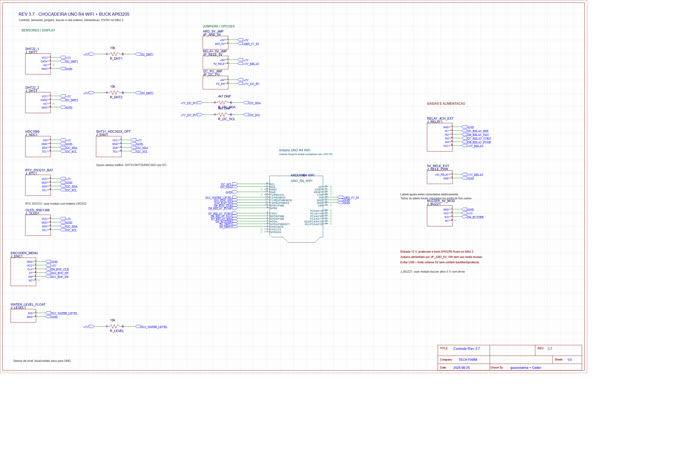
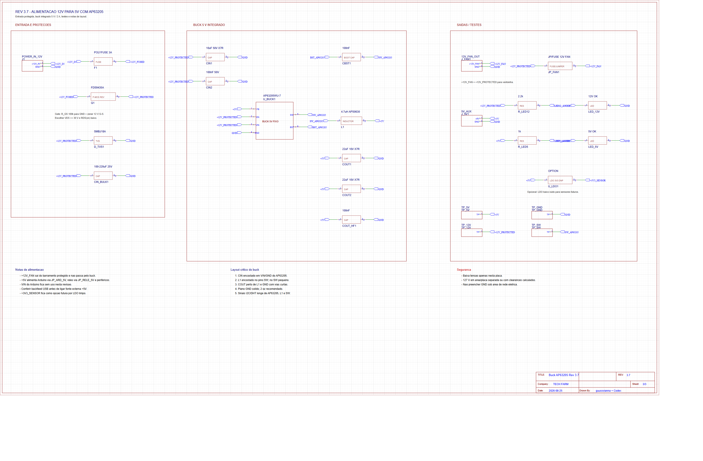

# Chocadeira PCB Controller

Projeto de hardware para uma controladora de chocadeira baseada em Arduino UNO R4 WiFi, com revisoes de esquematico EasyEDA, alimentacao 12 V -> 5 V por buck AP63205, RTC, encoder, sensores, rele e pontos de teste.

## O que esta no repo publico

- Revisao EasyEDA 3.7 em JSON.
- BOM preliminar da revisao 3.7.
- Notas tecnicas do buck AP63205 e protecoes de entrada.
- Capturas PNG do esquematico para leitura rapida.
- Pacotes EasyEDA exportados em `releases/`.

Arquivos de backup local, dados de aplicativo, historico bruto e caches foram deixados fora de proposito.

## Destaques tecnicos

- Entrada 12 V protegida com fusivel, MOSFET P-channel e TVS.
- Regulacao 5 V com AP63205, indutor 4.7 uH e capacitores especificados.
- Jumpers para isolar alimentacao do Arduino, rele e pull-ups I2C.
- RTC DS3231 para controle por fases e retomada apos queda.
- Encoder rotativo, buzzer ativo, sensor de nivel e sensor ambiental I2C opcional.
- Checklist de layout para manter sinais sensiveis longe do no SW do buck.

## Estrutura

```text
easyeda/             # JSONs EasyEDA e BOM
docs/                # notas tecnicas e screenshots
releases/            # pacotes de importacao EasyEDA
```

## Visual





## Portfolio

Este e um bom projeto publico porque mostra leitura de datasheet, tomada de decisao de hardware, BOM, revisoes tecnicas e organizacao de entregaveis de fabricacao. Veja [docs/portfolio-case-study.md](docs/portfolio-case-study.md).
