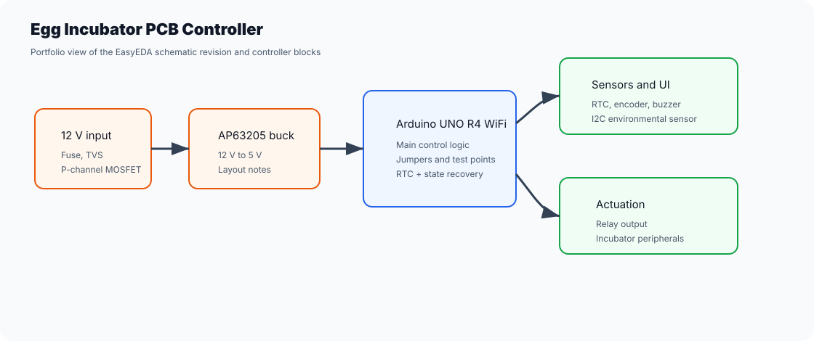

# Egg Incubator PCB Controller

🇧🇷 [Leia este README em Português (Brasil)](README.pt-BR.md).

Hardware case study for an Arduino UNO R4 WiFi egg-incubator controller, with EasyEDA schematic revisions, 12 V to 5 V power conversion through an AP63205 buck regulator, RTC, encoder, sensors, relay output and test points.



## What Is In This Public Repo

- EasyEDA 3.7 revision in JSON format.
- Preliminary BOM for revision 3.7.
- Technical notes for the AP63205 buck regulator and input protections.
- PNG schematic captures for quick review.
- EasyEDA import packages exported in `releases/`.

Local backups, application data, raw history and caches were intentionally left out.

## Technical Highlights

- 12 V input protected with fuse, P-channel MOSFET and TVS.
- 5 V regulation using AP63205, a 4.7 uH inductor and specified capacitors.
- Jumpers to isolate Arduino power, relay power and I2C pull-ups.
- DS3231 RTC for staged control and recovery after power loss.
- Rotary encoder, active buzzer, level sensor and optional I2C environmental sensor.
- Layout checklist to keep sensitive signals away from the buck regulator switching node.

## Structure

```text
easyeda/             # JSONs EasyEDA e BOM
docs/                # notas tecnicas e screenshots
releases/            # pacotes de importacao EasyEDA
```

## Visuals


## Portfolio

This is a useful public portfolio project because it shows datasheet reading, hardware decision-making, BOM organization, technical revisions, repository checks and fabrication-ready deliverables. See [docs/portfolio-case-study.md](docs/portfolio-case-study.md).
